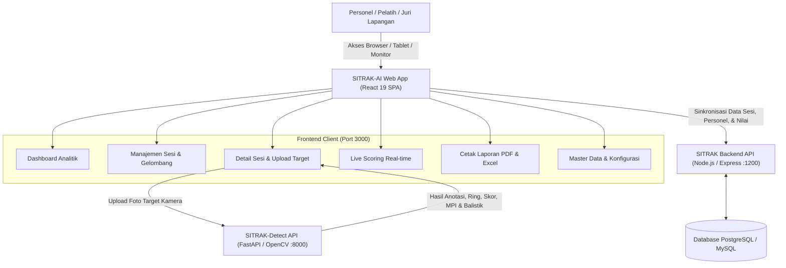

# SITRAK-AI (Sistem Informasi Tracking & Penilaian Menembak)

<p align="center">
  
</p>

<p align="center">
  <strong>Platform Pemantauan, Penilaian, dan Analisis Taktis Latihan Menembak Berbasis Computer Vision & AI</strong>
</p>

<p align="center">
  
  
  
  
  
</p>

---

## 📋 Daftar Isi
1. [Tentang Proyek](#-tentang-proyek)
2. [Arsitektur Sistem](#-arsitektur-sistem)
3. [Fitur-Fitur Utama](#-fitur-fitur-utama)
4. [Struktur Direktori](#-struktur-direktori)
5. [Prasyarat Sistem](#-prasyarat-sistem)
6. [Instalasi dan Konfigurasi](#-instalasi-dan-konfigurasi)
7. [Menjalankan Aplikasi](#-menjalankan-aplikasi)
8. [Navigasi dan Pintasan Keyboard](#-navigasi-dan-pintasan-keyboard)
9. [Dependensi Utama](#-dependensi-utama)
10. [Lisensi & Kontribusi](#-lisensi--kontribusi)

---

## 🎯 Tentang Proyek

**SITRAK-AI** (*Sistem Informasi Tracking & Penilaian Menembak*) adalah aplikasi frontend modern berbasis Single-Page Application (SPA) yang dirancang khusus untuk memodernisasi penilaian, manajemen sesi, pemantauan langsung (*live scoring*), serta evaluasi balistik dalam latihan menembak militer maupun olahraga presisi.

Aplikasi ini terhubung secara *real-time* dengan:
- **Backend API SITRAK**: Manajemen basis data sesi, pembagian gelombang (*waves*), babak (*rounds*), kuota peluru, master data personel, serta pencatatan skor.
- **Microservice SITRAK-Detect**: Mesin AI Computer Vision (FastAPI & OpenCV) yang mendeteksi lubang peluru (*bullet holes*), koreksi perspektif lesan target, penentuan skor zona ring 1–10/X, perhitungan radius sebaran (*grouping* mm), pergeseran titik perkenaan rata-rata (*Mean Point of Impact* / MPI $X/Y$), serta evaluasi taktis pelatih otomatis.

---

## 🏛 Arsitektur Sistem



---

## 🚀 Fitur-Fitur Utama

### 1. 📊 Dashboard Analitik Eksekutif
- **Statistik Riil Langsung dari Backend**: Menghitung total sesi, sesi berlangsung/selesai/menunggu/dibatalkan, total personel penembak, akumulasi butir peluru, dan rerata akurasi sistem.
- **Grafik Tren & Distribusi**:
  - Tren frekuensi latihan bulanan (*Line/Bar Chart*).
  - Distribusi predikat kualifikasi personel (*Istimewa, Mahir, Cukup, Perlu Pembinaan*).
  - Ringkasan penggunaan kaliber dan model senjata.
- **Daftar Latihan Berlangsung**: Akses cepat menuju sesi yang sedang aktif di lapangan.

### 2. 🎯 Manajemen Sesi Latihan Menembak
- **Filter & Pencarian Lanjutan**: Berdasarkan tanggal, status pelaksanaan, tempat lapangan tembak, jenis senjata, dan tipe sasaran.
- **Pembuatan Sesi Fleksibel (`ModalTambahSesi`)**:
  - Pengaturan gelombang penembak (*wave management*) dan alokasi jalur tembak (*lane assignment*).
  - Konfigurasi multi-babak (*multi-round*), seperti Babak Perkenaan/Koreksi, Penilaian Slow Fire, dan Rapid Fire lengkap dengan kuota butir peluru.
  - Penugasan personel penembak dari daftar master data personel.

### 3. 🔍 Detail Sesi & Deteksi Target Berbasis AI (`ModalUploadTargetDetect`)
- **Pemrosesan Foto Kamera Lapangan**: Kompresi otomatis gambar di sisi peramban sebelum dikirim ke mesin inferensi Computer Vision.
- **Deteksi Lubang Peluru Presisi**:
  - Identifikasi otomatis titik koordinat $(X, Y)$ setiap proyektil.
  - Penentuan nilai zona ring ($1$ sampai $10 / X\text{ Bullseye}$).
  - Pengukuran deviasi jarak dari titik pusat sasaran ($\text{mm}$).
  - Analisis *grouping radius* dan deviasi sumbu horizontal/vertikal ($\text{MPI } X/Y$).
- **AI Tactical Coach (Analisis Taktis Pelatih)**:
  - Deteksi kecondongan tembakan (*Trigger Jerking*, *Heeling*, *Thumbing*, atau *Breaking Wrist*).
  - Rekomendasi perbaikan teknik penarikan picu, genggaman, dan pengaturan nafas.
  - Peringatan otomatis jika butir peluru terdeteksi tidak sesuai dengan kuota babak.

### 4. 📺 Papan Skor Langsung (Live Scoring)
- **Tampilan Khusus Layar Monitor & Proyektor Lapangan**:
  - Mode Layar Penuh (*Fullscreen F11*).
  - Auto-refresh *real-time* dengan hitung mundur (*countdown*) dan status LIVE berkedip.
  - Dukungan multi-tampilan: **Lesan Vektor SVG**, **Foto Kamera AI**, atau **Split Berdampingan**.
- **Mode Semua Lane (Grid View)**:
  - Memantau seluruh penembak dalam satu gelombang dan babak secara bersamaan.
  - Peringkat skor tertinggi (*Leaderboard* podium).
  - Tombol aksi instan *Livescore Per Orang* di tiap kartu jalur.
- **Mode Fokus Perorangan (Individual Live Score)**:
  - Target vektor SVG resolusi tinggi dengan 10 ring konsentris, label ring, garis *crosshairs*, serta lingkaran sebaran grouping balistik.
  - **Sorot Dua Arah (*Two-Way Highlighting*)**: Mengklik atau mengarahkan kursor pada titik peluru di target akan menyorot baris butir peluru di tabel, begitu pula sebaliknya.
  - Kartu profil personel, 4 kartu KPI live (*Skor Babak, Bullseye, Balistik/Grouping, Total Akumulasi*).
  - Tabel rincian tembakan tiap butir (*shot-by-shot table*) lengkap dengan koordinat dan jarak pusat ($\text{mm}$).
  - Rekapitulasi riwayat multi-babak (*round scorecard*) dengan tombol alih babak langsung.
- **Fitur Hide / Show Toolbar**:
  - Kemampuan menyembunyikan panel toolbar kontrol dan navigasi untuk memaksimalkan area tampilan visual sasaran tembak di monitor lapangan.

### 5. 🖨️ Cetak Laporan & Ekspor Data (`ModalCetakLaporan`)
- **Format Laporan Resmi Berstandar Militer**:
  - Lembar ringkasan per gelombang (*wave roster*).
  - Lembar penilaian per babak (*round score sheet*).
  - Lembar rekapitulasi nilai akhir sesi dan predikat kelulusan.
  - Kartu penilaian individu (*individual scorecard*) lengkap dengan foto sasaran anotasi AI.
- **Kustomisasi Cetak**:
  - Opsi sertakan/hilangkan catatan analisis taktis pelatih.
  - Opsi sertakan/hilangkan data balistik & grouping.
  - Tombol cetak langsung ke format PDF atau printer fisik dengan penomoran halaman rapi.

### 6. ⚙️ Pengaturan & Master Data Terpadu
- Pengelolaan master data Senjata, Kaliber, Tempat Menembak, Sikap Menembak, Mode Tembakan, Tipe Target Lesan, dan Master Personel.
- Pemeriksaan diagnostik status jaringan dan koneksi API Backend & SITRAK-Detect.

### 7. 🌐 Kompatibilitas Jaringan Multi-Device (LAN)
- Terintegrasi dengan modul cerdas [`apiConfig.js`](src/services/apiConfig.js) yang secara dinamis menyelaraskan alamat IP backend saat diakses dari perangkat tablet, laptop, atau ponsel lain pada jaringan Wi-Fi/LAN lapangan tembak yang sama tanpa ketergantungan *hardcoded localhost*.

---

## 📁 Struktur Direktori

```text
sitrak/
├── public/
│   ├── favicon.ico
│   ├── index.html                      # Template HTML utama & Google Fonts
│   ├── manifest.json
│   ├── SITRAK Tactical Analytics Emblem.png
│   └── SITRAK Tactical Target Emblem.png
├── src/
│   ├── component/
│   │   ├── modal/
│   │   │   ├── ModalCetakLaporan.js    # Cetak laporan resmi PDF/Kertas
│   │   │   ├── ModalTambahSesi.js      # Form sesi, gelombang & babak
│   │   │   └── ModalUploadTargetDetect.js # Upload kamera & deteksi AI
│   │   ├── Breadcrumb.js               # Navigasi remah roti
│   │   ├── Navbar.js                   # Navigasi responsif mobile
│   │   └── Sidebar.js                  # Navigasi desktop utama
│   ├── images/
│   │   └── litpers.png
│   ├── pages/
│   │   ├── Dashboard.js                # Halaman dashboard & statistik real
│   │   ├── DetailSesi.js               # Halaman kerja penilaian sesi
│   │   ├── Latihan.js                  # Daftar & manajemen sesi latihan
│   │   ├── LiveScoring.js              # Papan skor langsung (Grid & Individual)
│   │   ├── NotFound.js                 # Halaman penanganan 404
│   │   └── Pengaturan.js               # Master data sistem & diagnostik
│   ├── services/
│   │   ├── apiConfig.js                # Resolusi dinamis URL Backend & LAN
│   │   └── sitrakDetectService.js      # Klien inferensi AI & evaluasi taktis
│   ├── App.css
│   ├── App.js                          # Konfigurasi router & rute halaman
│   ├── index.css
│   └── index.js                        # Entri aplikasi React DOM
├── .env.example                        # Template variabel lingkungan
├── package.json                        # Konfigurasi proyek & pustaka dependensi
└── README.md                           # Dokumentasi proyek
```

---

## 💻 Prasyarat Sistem

Sebelum menjalankan aplikasi, pastikan sistem Anda telah terpasang:
- **Node.js**: Versi `18.x` atau yang lebih baru (disarankan LTS).
- **NPM**: Versi `9.x` atau yang lebih baru (atau menggunakan Yarn / PNPM).
- **Peramban Web Modern**: Google Chrome, Microsoft Edge, atau Mozilla Firefox dengan dukungan JavaScript modern dan SVG.
- *(Opsional untuk pemrosesan AI)*: Layanan **SITRAK-Backend** (`:1200`) dan **SITRAK-Detect** (`:8000`) yang berjalan pada server lokal/LAN.

---

## ⚙️ Instalasi dan Konfigurasi

### 1. Salin Berkas Lingkungan (*Environment Variables*)
Salin berkas `.env.example` menjadi `.env` di direktori utama:

```bash
cp .env.example .env
```

Atau pada Windows PowerShell:

```powershell
Copy-Item .env.example .env
```

### 2. Sesuaikan Pengaturan pada `.env`
Buka berkas `.env` dan sesuaikan alamat IP/Port server target:

```ini
# URL Layanan SITRAK Backend (Node.js / Express)
REACT_APP_BACKEND_URL=http://localhost:1200

# URL Layanan SITRAK-Detect (FastAPI / OpenCV / Computer Vision)
REACT_APP_DETECT_API_URL=http://localhost:8000

# Google Gemini API Key untuk Deteksi Sasaran Tembak (Cloud Multimodal AI)
REACT_APP_GEMINI_API_KEY=AIzaSy...
REACT_APP_GEMINI_MODEL=gemini-2.5-flash

# Nonaktifkan source map pada build produksi untuk performa maksimal
GENERATE_SOURCEMAP=false
```

> **Deteksi Target Berbasis Google Gemini Cloud AI:**
> Anda dapat menggunakan model vision Google Gemini untuk mendeteksi perkenaan peluru dan analisis balistik secara langsung tanpa bergantung pada GPU lokal. Cukup cantumkan API Key Anda pada `REACT_APP_GEMINI_API_KEY` di file `.env`. Mesin deteksi dapat dipilih langsung dari opsi engine di dialog upload target (*Google Gemini Cloud AI*).

> **Catatan Multi-Device:** Jika aplikasi diakses oleh tablet/perangkat lain di lapangan melalui alamat IP lokal (misalnya `http://192.168.1.50:3000`), modul [`apiConfig.js`](src/services/apiConfig.js) secara otomatis menyelaraskan permintaan API ke host yang bersangkutan.

### 3. Pasang Dependensi
Jalankan perintah berikut untuk mengunduh seluruh dependensi paket:

```bash
npm install
```

---

## 🏃 Menjalankan Aplikasi

### Mode Pengembangan (Development)
Menjalankan server pengembangan lokal dengan fitur *hot-reloading*:

```bash
npm start
```
Aplikasi akan dapat diakses melalui peramban di: **`http://localhost:3000`**.

### Kompilasi Produksi (Production Build)
Membuat bundel produksi yang dioptimalkan, diminifikasi, dan siap dideploy ke server web (Nginx, Apache, atau serve):

```bash
npm run build
```
Hasil build akan berada pada folder `build/`.

### Menguji Aplikasi (Test Runner)
Menjalankan pengujian unit interaktif:

```bash
npm test
```

---

## ⌨️ Navigasi dan Pintasan Keyboard

Pada halaman **Live Scoring**, tersedia tombol pintasan keyboard (*keyboard shortcuts*) untuk mempermudah operator di lapangan:

| Pintasan Keyboard | Fungsi / Aksi |
| :--- | :--- |
| **`H`** atau **`T`** | Menyembunyikan atau memunculkan bilah *Toolbar* & Navigasi (*Toggle Hide/Show Toolbar*). |
| **`←` (Panah Kiri)** | Beralih ke penembak sebelumnya (*Mode Fokus Perorangan*). |
| **`→` (Panah Kanan)** | Beralih ke penembak selanjutnya (*Mode Fokus Perorangan*). |
| **`ESC`** | Keluar dari Mode Fokus Perorangan dan kembali ke Mode Semua Lane (*Grid*). |
| **`F11`** | Beralih ke tampilan layar penuh (*Fullscreen Mode* proyektor). |

---

## 📦 Dependensi Utama

| Paket | Versi | Kegunaan |
| :--- | :--- | :--- |
| **react** | `^19.3.0` | Pustaka inti antarmuka pengguna (*UI Library*) |
| **react-dom** | `^19.3.0` | Mesin perender React untuk peramban DOM |
| **react-router-dom** | `^6.4.2` | Manajemen rute dan navigasi halaman SPA |
| **bootstrap** | `^5.3.8` | Kerangka kerja styling UI responsif |
| **bootstrap-icons** | `^1.13.1` | Kumpulan ikon vektor taktis dan navigasi |
| **axios** | `^0.27.2` | Klien HTTP berbasis promise untuk komunikasi REST API |
| **chart.js** | `^4.4.1` | Pustaka pembuatan grafik analitik di Dashboard |
| **browser-image-compression** | `^2.0.2` | Kompresi resolusi foto sasaran sebelum dianalisis AI |
| **xlsx** | `^0.18.5` | Pembuatan dan ekspor data laporan tabular Excel |

---

## 📄 Lisensi & Kontribusi

Proyek ini dikembangkan untuk kebutuhan operasional pencatatan dan evaluasi latihan menembak terintegrasi **SITRAK-AI**. Seluruh hak cipta dan merek dagang dilindungi.

Untuk pembaruan fitur atau pelaporan kendala (*bug report*), hubungi tim pengembang sistem SITRAK.
