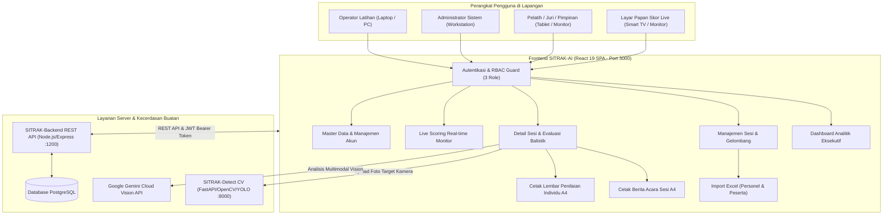

# SITRAK-AI (Sistem Informasi Tembakan & Rekapitulasi Akurasi Taktis)

<p align="center">
  
</p>

<p align="center">
  <strong>Platform Pemantauan, Penilaian, Deteksi Lesan Berbasis Computer Vision & AI, serta Rekapitulasi Latihan Menembak Terintegrasi</strong>
</p>

<p align="center">
  
  
  
  
  
  
  
</p>

---

## 📋 Daftar Isi
1. [Tentang Proyek](#-tentang-proyek)
2. [Arsitektur Sistem](#-arsitektur-sistem)
3. [Fitur-Fitur Utama Terkini](#-fitur-fitur-utama-terkini)
4. [Struktur Direktori Proyek](#-struktur-direktori-proyek)
5. [Prasyarat Sistem](#-prasyarat-sistem)
6. [Panduan Instalasi di Device Baru](#-panduan-instalasi-di-device-baru)
7. [Menjalankan Aplikasi](#-menjalankan-aplikasi)
8. [Panduan Akses Jaringan Multi-Device (LAN / Lapangan Tembak)](#-panduan-akses-jaringan-multi-device-lan--lapangan-tembak)
9. [Navigasi & Pintasan Keyboard](#-navigasi--pintasan-keyboard)
10. [Pengujian Unit (Unit Testing)](#-pengujian-unit-unit-testing)
11. [Solusi Kendala Umum (Troubleshooting)](#-solusi-kendala-umum-troubleshooting)
12. [Lisensi & Kontribusi](#-lisensi--kontribusi)

---

## 🎯 Tentang Proyek

**SITRAK-AI** (*Sistem Informasi Tembakan & Rekapitulasi Akurasi Taktis*) adalah aplikasi frontend Single-Page Application (SPA) modern yang dibangun dengan React 19. Aplikasi ini dirancang khusus untuk memenuhi kebutuhan pencatatan nilai, manajemen gelombang dan jalur tembak, pemantauan langsung (*live scoring*), serta evaluasi balistik taktis berbasis **Computer Vision (OpenCV & YOLO)** dan **Multimodal Vision AI (Google Gemini)** dalam latihan menembak presisi militer (Kodiklat TNI / Mabes TNI) maupun olahraga kedinasan.

Aplikasi ini beroperasi secara terintegrasi dengan ekosistem:
1. **SITRAK-Backend (`:1200`)**: Backend REST API berbasis Node.js/Express yang terhubung ke database **PostgreSQL** (manajemen sesi, gelombang, babak, otentikasi login pengguna, dan master data).
2. **SITRAK-Detect (`:8000`)**: Microservice Computer Vision berbasis FastAPI/Python + OpenCV & model YOLO untuk koreksi perspektif sasaran, segmentasi lesan ring 1–10/X, deteksi lubang peluru, kalkulasi sebaran (*grouping spread* mm), dan titik perkenaan rata-rata (*Mean Point of Impact* / MPI $X/Y$).
3. **Google Gemini Multimodal Vision API**: Mesin cloud vision alternatif berakurasi tinggi dengan diskriminasi balistik canggih untuk membedakan lubang peluru tembakan asli vs tambalan penutup lesan (*pasters / target repair stickers*).

---

## 🏛 Arsitektur Sistem



---

## 🚀 Fitur-Fitur Utama Terkini

### 1. 🔐 Sistem Autentikasi Riil & Role-Based Access Control (RBAC) 3 Role
- Terintegrasi penuh dengan database **PostgreSQL** (tabel `users`) melalui endpoint backend `/auth/login` dengan enkripsi token JWT.
- **Bebas Kredensial Hardcoded**: Seluruh otentikasi diverifikasi langsung ke server backend tanpa data akun dummy tertanam di kode sumber.
- **3 Role Standar Sistem**:
  1. **Operator Latihan (`operator`)**: Membuat dan mengelola sesi latihan, mengunggah foto sasaran target, menjalankan deteksi nilai, memantau papan skor, dan menyiapkan dokumen laporan.
  2. **Administrator (`administrator`)**: Mengelola master data sistem, menguji konektivitas layanan (Backend, SITRAK-Detect, Gemini AI), mengelola akun pengguna (tambah akun baru, reset password, hapus akun), serta pemeliharaan konfigurasi.
  3. **Pelatih / Juri / Pimpinan (`pelatih`)**: Memantau skor jalannya latihan secara *real-time*, meninjau rekapitulasi, dan menggunakan laporan resmi sebagai bahan evaluasi taktis.
- **Isolasi Header HTTP**: Header `Authorization: Bearer <token>` SITRAK dilindungi secara cerdas dengan *interceptor* agar tidak pernah bocor ke Google Gemini API, mencegah error konflik otentikasi ganda (*Expected only one form of authentication*).

### 2. 📥 Bulk Import Data via Excel (Personel & Peserta Sesi)
- **Import Master Data Personel (`ModalImportExcelPersonel.js`)**: Pada menu Pengaturan, administrator dapat mengunduh template Excel resmi (`Template_Master_Personel_SITRAK.xlsx`) dan melakukan penambahan/pembaruan massal ribuan data personel langsung ke PostgreSQL.
- **Import Peserta Sesi Latihan (`ModalImportPesertaSesi.js`)**: Saat konfigurasi sesi tembak, operator dapat mengunggah file Excel daftar peserta (`Template_Peserta_Latihan_SITRAK.xlsx`).
- **Deduplikasi Cerdas Berbasis NRP**: Sistem secara otomatis memeriksa NRP:
  - Jika personel sudah terdaftar di database, sistem menggunakannya tanpa menduplikasi data master.
  - Jika personel belum ada di database, sistem otomatis menambahkannya ke master data dan langsung mengalokasikannya ke jalur/gelombang sesi.

### 3. 🎯 Deteksi Target Ganda (Dual-Engine: SITRAK-Detect & Google Gemini AI)
- **SITRAK-Detect (Local Computer Vision)**: Koreksi perspektif 4 sudut lesan, segmentasi cincin ISSF/Militer, deteksi lubang peluru berbasis model YOLO & kontur OpenCV lokal.
- **Google Gemini Cloud Multimodal Vision**:
  - Model aktif: `gemini-2.5-flash` atau `gemini-3.5-flash-lite`.
  - **Diskriminasi Lubang vs Tambalan**: Prompt balistik yang dioptimalkan untuk membedakan lubang tembakan baru (*ragged torn paper fibers* 3D warna putih/abu-abu robekan serat kertas) dengan stiker/lakban tambalan sasaran tembak lama (*flat target repair patches / pasters*).
- **Kompatibilitas Kamera Mobile (Android & iOS Safari)**: Pengunggahan foto sasaran dilengkapi pemilih berkas responsif dan tombol **"Buka Kamera Langsung"** (`capture="environment"` / `facingMode: "environment"`).

### 4. 🖨️ Cetak Dokumen Laporan Resmi A4 (Sesi & Individu)
- **Laporan Rekapitulasi Sesi Latihan (`DokumenLaporanSesi` / `ModalCetakLaporan.js`)**:
  - Format Berita Acara Rekapitulasi Nilai Latihan Menembak A4 Portrait standar dinas/militer.
  - Ringkasan per gelombang, perolehan nilai tiap babak, statistik penembak terbaik (*shooter of the day*), dan distribusi predikat.
- **Laporan Hasil Menembak Perorangan / Individu (`DokumenLaporanIndividu` / `ModalCetakLaporanIndividu.js`)**:
  - Format **Lembar Hasil & Evaluasi Menembak Perorangan (LHMP)** khusus untuk satu personel.
  - Profil lengkap penembak (Nama, Pangkat, NRP, Satuan, Gelombang, Lane, Senjata, Kaliber, Jarak, Lapangan).
  - Scorecard Banner predikat kelulusan (*Istimewa, Mahir, Cukup, Perlu Pembinaan*).
  - Tabel rincian penilaian per babak (Koreksi 3 peluru, Penilaian 10 peluru, nilai, akurasi %, grouping spread mm, deviasi MPI $X/Y$).
  - **Dokumentasi Visual Ganda**: Diagram sasaran target ring konsentris SVG dengan plot titik tembakan bernomor `#1`, `#2`, dll., bersanding dengan foto kamera asli hasil anotasi AI.
  - Diagnosa balistik biomekanik (analisis tarikan picu, cengkeraman *grip*, konsistensi nafas, dan arah bias tembakan).
  - Lembar pengesahan resmi dengan 3 kolom tanda tangan: **Penembak Yang Bersangkutan**, **Petugas Operator SITRAK**, dan **Penanggung Jawab Latihan (Wasdal)**.
  - Akses cetak langsung di setiap baris tabel penembak, di header visualizer target, maupun di modal cetak utama.

### 5. 📺 Papan Skor Langsung (Live Scoring)
- Tampilan monitor & proyektor lapangan (*Fullscreen F11*).
- Auto-refresh dengan hitung mundur dan status LIVE berkedip.
- Mode Grid Semua Lane & Mode Fokus Perorangan dengan sorot dua arah (*Two-Way Highlighting* antara titik target dan tabel perkenaan).
- Tombol pintasan sembunyikan bilah toolbar (`H` / `T`) untuk visual maksimal di monitor lapangan tembak.

---

## 📁 Struktur Direktori Proyek

```text
sitrak/
├── public/
│   ├── favicon.ico
│   ├── index.html                      # Template HTML utama & Google Fonts
│   ├── manifest.json
│   ├── SITRAK Tactical Analytics Emblem.png # Logo Emblem Dokumen Resmi
│   └── SITRAK Tactical Target Emblem.png    # Logo Lesan Sasaran SITRAK
├── src/
│   ├── component/
│   │   ├── modal/
│   │   │   ├── ModalCetakLaporan.js         # Cetak Rekapitulasi Sesi A4
│   │   │   ├── ModalCetakLaporanIndividu.js # Cetak Lembar Penilaian Individu A4
│   │   │   ├── ModalEditUser.js             # Modal Edit & Reset Password Pengguna
│   │   │   ├── ModalImportExcelPersonel.js  # Import Master Data Personel via Excel
│   │   │   ├── ModalImportPesertaSesi.js    # Import Peserta Sesi via Excel (Deduplikasi NRP)
│   │   │   ├── ModalTambahSesi.js           # Form Pembuatan Sesi, Gelombang & Babak
│   │   │   ├── ModalTambahUser.js           # Pendaftaran Akun Pengguna Baru (Admin)
│   │   │   └── ModalUploadTargetDetect.js   # Upload / Kamera Langsung & Deteksi AI
│   │   ├── Breadcrumb.js                    # Navigasi remah roti
│   │   ├── Navbar.js                        # Navigasi responsif mobile
│   │   ├── ProtectedRoute.js                # Penjaga rute terautentikasi & RBAC Guard
│   │   └── Sidebar.js                       # Navigasi sidebar desktop utama
│   ├── images/
│   │   └── litpers.png
│   ├── pages/
│   │   ├── Dashboard.js                     # Dashboard statistik analitik riil
│   │   ├── DetailSesi.js                    # Halaman kerja penilaian & target visualizer
│   │   ├── Latihan.js                       # Daftar & manajemen sesi latihan
│   │   ├── LiveScoring.js                   # Papan skor langsung (Grid & Individual)
│   │   ├── Login.js                         # Portal autentikasi login 3 role
│   │   ├── NotFound.js                      # Penanganan halaman 404
│   │   └── Pengaturan.js                    # Master data, konektivitas & akun user
│   ├── services/
│   │   ├── apiConfig.js                     # Resolusi dinamis URL Backend & LAN
│   │   ├── authService.js                   # Layanan autentikasi PostgreSQL & RBAC
│   │   ├── geminiDetectService.js           # Klien Google Gemini Vision terisolasi
│   │   ├── importPesertaService.js          # Generator template & parser Excel peserta
│   │   └── sitrakDetectService.js           # Klien inferensi Computer Vision & balistik
│   ├── App.css                              # Styling utama & aturan cetak @media print A4
│   ├── App.js                               # Definisi router & rute terlindungi
│   ├── index.css
│   └── index.js                             # Entri React DOM
├── .env.example                             # Template variabel lingkungan
├── package.json                             # Konfigurasi dependensi npm
└── README.md                                # Dokumentasi panduan proyek
```

---

## 💻 Prasyarat Sistem

Sebelum memasang aplikasi pada komputer/device baru, pastikan perangkat telah memenuhi prasyarat berikut:

| Komponen | Spesifikasi Minimum | Rekomendasi |
| :--- | :--- | :--- |
| **Sistem Operasi** | Windows 10/11 (64-bit), Ubuntu 20.04+, atau macOS | Windows 11 / Ubuntu 22.04 LTS |
| **Node.js** | Versi `18.x` | Versi `20.x LTS` atau `22.x LTS` |
| **NPM** | Versi `9.x` | Versi `10.x` |
| **Peramban Web** | Chrome 110+, Edge 110+, Safari 16+, Firefox 115+ | Google Chrome / Microsoft Edge versi terbaru |
| **Konektivitas Jaringan** | Terhubung ke LAN/Wi-Fi yang sama dengan Server SITRAK | Jaringan Wi-Fi / LAN kabel 1 Gbps |

---

## 🛠 Panduan Instalasi di Device Baru

Ikuti langkah-langkah di bawah ini untuk memasang dan menjalankan proyek SITRAK di komputer atau laptop baru:

### Langkah 1: Pasang Node.js & Git
1. Unduh dan pasang **Node.js LTS** dari situs resmi: [https://nodejs.org/](https://nodejs.org/).
2. Pastikan instalasi berhasil dengan membuka Terminal / Command Prompt / PowerShell:
   ```bash
   node -v
   npm -v
   ```
   *(Harus menampilkan versi Node.js v18+ dan npm v9+)*.
3. *(Opsional)* Unduh dan pasang **Git** dari: [https://git-scm.com/](https://git-scm.com/).

---

### Langkah 2: Salin Proyek ke Device Baru
Anda dapat mengunduh atau mengkloning repositori proyek ke direktori kerja yang diinginkan:

```bash
# Menggunakan Git Clone
git clone <URL_REPOSITORY_SITRAK> sitrak
cd sitrak
```

Atau salin folder proyek `sitrak` langsung (misalnya via flashdisk atau arsip ZIP) ke direktori tujuan (contoh: `D:\Projects\sitrak` atau `~/projects/sitrak`), lalu buka terminal di dalam folder tersebut.

---

### Langkah 3: Konfigurasi Berkas Lingkungan (`.env`)
Aplikasi membutuhkan berkas `.env` untuk mengenali alamat backend dan API AI. Salin template `.env.example`:

**Pada Windows PowerShell:**
```powershell
Copy-Item .env.example .env
```

**Pada Linux / macOS / Bash:**
```bash
cp .env.example .env
```

Buka berkas `.env` yang baru dibuat dengan teks editor (VS Code, Notepad, dll.), lalu sesuaikan nilainya:

```ini
# ==============================================================================
# SITRAK - Environment Variables Configuration
# ==============================================================================

# 1. URL Layanan SITRAK Backend (Node.js / Express & PostgreSQL)
# Jika backend berada di komputer yang sama (localhost):
REACT_APP_BACKEND_URL=http://localhost:1200
# Jika backend berada di komputer server lain dalam satu LAN (contoh IP server: 192.168.1.50):
# REACT_APP_BACKEND_URL=http://192.168.1.50:1200

# 2. URL Layanan SITRAK-Detect (Microservice Computer Vision / OpenCV / YOLO)
# Jika detect engine berada di localhost:
REACT_APP_DETECT_API_URL=http://localhost:8000
# Jika detect engine berada di server LAN lain:
# REACT_APP_DETECT_API_URL=http://192.168.1.50:8000

# 3. Kunci API Google Gemini (Opsional tapi sangat direkomendasikan untuk AI Vision)
# Dapatkan API Key gratis di https://aistudio.google.com/
REACT_APP_GEMINI_API_KEY=AIzaSyBxxxxxxxxxxxxxxxxxxxxxxxxxxxxxxx
REACT_APP_GEMINI_MODEL=gemini-2.5-flash

# 4. Optimasi Build Produksi
GENERATE_SOURCEMAP=false
```

---

### Langkah 4: Pasang Dependensi Proyek (`npm install`)
Jalankan perintah instalasi paket dependensi:

```bash
npm install
```

> 💡 **Catatan untuk Pengguna Windows PowerShell:**
> Jika saat menjalankan script npm muncul pesan error:
> `File ...\npm.ps1 cannot be loaded because running scripts is disabled on this system`,
> Anda dapat menjalankan perintah menggunakan ekstensi `.cmd`:
> ```powershell
> npm.cmd install
> ```
> Atau buka PowerShell sebagai Administrator dan izinkan eksekusi script lokal:
> ```powershell
> Set-ExecutionPolicy -Scope CurrentUser -ExecutionPolicy RemoteSigned
> ```

---

## 🏃 Menjalankan Aplikasi

### 1. Menjalankan Mode Pengembangan (*Development Server*)
Untuk memulai aplikasi di lingkungan lokal:

```bash
npm start
```
*(Atau `npm.cmd start` pada Windows PowerShell)*.

Aplikasi akan otomatis terkompilasi dan terbuka di browser pada alamat:
👉 **`http://localhost:3000`**

---

### 2. Membangun Bundel Produksi (*Production Build*)
Untuk mengompilasi aplikasi menjadi berkas statis siap pakai (*optimized HTML, CSS, JS*):

```bash
npm run build
```
Hasil kompilasi akan tersimpan di dalam folder `build/`.

Untuk menjalankan hasil build produksi secara lokal menggunakan web server statis:
```bash
# Pasang serve secara global (cukup sekali)
npm install -g serve

# Jalankan server dari folder build
serve -s build -l 3000
```

---

## 🌐 Panduan Akses Jaringan Multi-Device (LAN / Lapangan Tembak)

SITRAK-AI telah dilengkapi modul cerdas [`src/services/apiConfig.js`](src/services/apiConfig.js) yang mendukung pengoperasian multi-perangkat di lapangan tembak (operator laptop, tablet pelatih, dan monitor proyektor).

### Cara Menghubungkan Device Lain (Tablet / Laptop / Monitor TV):
1. Pastikan seluruh perangkat (Server/PC utama dan Tablet/Device lapangan) terhubung pada **jaringan Wi-Fi atau switch LAN yang sama**.
2. Cari tahu alamat IP Lokal komputer server (misalnya pada Windows jalankan `ipconfig` di CMD; cari IPv4 seperti `192.168.1.100` atau `172.16.24.212`).
3. Buka browser (Chrome / Safari) di tablet atau perangkat lain, lalu masukkan alamat:
   ```text
   http://192.168.1.100:3000
   ```
4. Modul [`apiConfig.js`](src/services/apiConfig.js) secara otomatis akan mengarahkan request API backend dan microservice deteksi ke host IP yang sama (`http://192.168.1.100:1200` dan `http://192.168.1.100:8000`).

---

## ⌨️ Navigasi & Pintasan Keyboard

Pada layar **Live Scoring** (Papan Skor Langsung), gunakan tombol pintasan (*shortcuts*) berikut untuk pengoperasian cepat di monitor lapangan:

| Pintasan Keyboard | Aksi / Fungsi |
| :---: | :--- |
| **`H`** atau **`T`** | Menyembunyikan / menampilkan bilah navigasi dan toolbar (*Toggle Toolbar*). |
| **`←` (Panah Kiri)** | Beralih ke penembak sebelumnya pada Mode Fokus Perorangan. |
| **`→` (Panah Kanan)** | Beralih ke penembak selanjutnya pada Mode Fokus Perorangan. |
| **`ESC`** | Keluar dari Mode Fokus Perorangan dan kembali ke Mode Semua Lane (*Grid View*). |
| **`F11`** | Masuk ke mode layar penuh (*Fullscreen*) untuk tampilan proyektor. |
| **`Ctrl + P`** | Membuka dialog pratinjau cetak dokumen laporan resmi. |

---

## 🧪 Pengujian Unit (Unit Testing)

Aplikasi memiliki rangkaian uji otomatis (*automated test suites*) menggunakan Jest dan React Testing Library untuk memastikan integritas logika otentikasi, isolasi API Gemini, validasi import Excel, dan perenderan dokumen cetak.

Untuk menjalankan seluruh rangkaian pengujian:

```bash
# Menjalankan seluruh pengujian unit
npx.cmd react-scripts test --watchAll=false
```

Daftar modul yang diuji:
- `src/services/authService.test.js`: Verifikasi 3 role, login backend, hak akses RBAC, dan pencegahan hardcoded credentials.
- `src/services/geminiDetectService.test.js`: Verifikasi isolasi Axios client Gemini dan pencegahan error otentikasi ganda.
- `src/services/importPesertaService.test.js`: Verifikasi parsing template Excel peserta dan deduplikasi NRP.
- `src/component/modal/ModalCetakLaporanIndividu.test.js`: Verifikasi perenderan dokumen lembar penilaian individu A4.
- `src/App.test.js`: Verifikasi perenderan portal login utama.

---

## 🔧 Solusi Kendala Umum (Troubleshooting)

### 1. Error: `API key for authentication is used with other authentication credentials`
- **Penyebab**: Header `Authorization` (JWT token login) ikut terkirim ke endpoint Google Generative Language API.
- **Solusi**: Masalah ini telah ditangani secara permanen melalui instance `geminiClient` terisolasi pada [`src/services/geminiDetectService.js`](src/services/geminiDetectService.js) dan request interceptor pada [`src/services/authService.js`](src/services/authService.js). Pastikan menggunakan versi kode terbaru.

### 2. Error: `React Hook "useMemo" is called conditionally (rules-of-hooks)`
- **Penyebab**: Terdapat pemanggilan early return sebelum deklarasi React Hook selesai dipanggil.
- **Solusi**: Seluruh guard condition di [`src/component/modal/ModalCetakLaporanIndividu.js`](src/component/modal/ModalCetakLaporanIndividu.js) telah diposisikan di bawah deklarasi hooks.

### 3. Gagal Terhubung ke Backend (`Network Error` / `ECONNREFUSED`)
- Pastikan service **SITRAK-Backend** (`:1200`) dan database **PostgreSQL** sudah berjalan.
- Periksa kesesuaian nilai `REACT_APP_BACKEND_URL` di berkas `.env`.
- Jika mengakses via LAN, pastikan Firewall pada komputer server mengizinkan koneksi masuk (*inbound rules*) pada port `1200`, `8000`, dan `3000`.

### 4. Kamera HP / Tablet Tidak Terbuka Saat Upload Target
- Pada perangkat Android Chrome & iOS Safari, gunakan tombol **"Buka Kamera Langsung"** pada dialog Upload Target.
- Pastikan izin kamera (*camera permission*) telah diberikan untuk browser tersebut pada pengaturan perangkat Anda.

---

## 📦 Dependensi Paket Utama

```json
{
  "dependencies": {
    "react": "^19.3.0",
    "react-dom": "^19.3.0",
    "react-router-dom": "^6.4.2",
    "bootstrap": "^5.3.8",
    "bootstrap-icons": "^1.13.1",
    "axios": "^0.27.2",
    "chart.js": "^4.4.1",
    "browser-image-compression": "^2.0.2",
    "xlsx": "^0.18.5",
    "copy-to-clipboard": "^3.3.3"
  }
}
```

---

## 📄 Lisensi & Kontribusi

Proyek ini dikembangkan secara terpadu untuk mendukung operasional modernisasi pencatatan, penilaian, dan analisis balistik latihan menembak **SITRAK-AI** (KODIKLAT TNI). Seluruh hak cipta dan merek dagang dilindungi.

Untuk pembaruan fitur, perbaikan bug, atau sinkronisasi backend, silakan hubungi tim pengembang sistem SITRAK.
